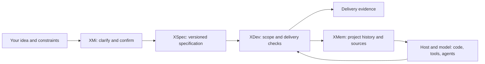

# X Suite

**Take your idea beyond the prototype.**

An open-source engineering governance and evidence toolkit for AI-assisted development in Codex.

**English** · [简体中文](README.zh-CN.md)

[Get started](INSTALL.md) · [XMi](https://github.com/NUVANU/XMi) · [XDev](https://github.com/NUVANU/XDev) · [XMem](https://github.com/NUVANU/XMem)

You describe a product, the AI starts coding, and the first demo looks promising. Then a small change breaks an earlier rule. A new chat forgets why a decision was made. “Tests passed” turns out to mean a different version was tested.

**X Suite makes the intent, project history, and evidence behind a delivery easier to inspect.** XMi clarifies what you want to build. XDev checks the scope and evidence of development. XMem keeps project knowledge traceable across sessions. Your coding host and model still do the development work.

## Why try X Suite?

| When AI development gets difficult | What X Suite adds |
| --- | --- |
| A short idea leaves important behavior undefined | **XMi:** guided clarification, visible open questions, and an owner-confirmed specification |
| A helpful suggestion quietly becomes an extra feature | **XMi + XDev:** separate proposals from decisions and check work against the approved scope |
| A new session loses a constraint or repeats a failed approach | **XMem:** retrieve project-bound history with sources, revisions, and applicability |
| The agent says “done,” but the tested code is unclear | **XDev:** bind implementation, Review, and actual QA evidence to the same Job and candidate |
| An interrupted operation leaves an uncertain result | **XDev + XMem:** reconcile original records before treating a retry or recovery as safe |

These are the problems the toolkit is designed to address. They are not measured claims that X Suite eliminates hallucinations or guarantees a successful product.

## Three tools, clear responsibilities



| Tool | The question it helps answer | Main outputs | License |
| --- | --- | --- | --- |
| [**XMi**](https://github.com/NUVANU/XMi) | What did the user actually agree to build? | Product model, decisions, acceptance criteria, XSpec | Apache-2.0 |
| [**XDev**](https://github.com/NUVANU/XDev) | Does this candidate have the evidence needed for this delivery? | Job records, scope checks, Review and QA receipts, delivery status | MPL-2.0 |
| [**XMem**](https://github.com/NUVANU/XMem) | What project knowledge is relevant, and where did it come from? | Versioned memories, source references, retrieval results, checkpoints | MPL-2.0 |

X Suite is the integration and documentation repository. The component source code stays in its own repositories. XMi can be used independently; the documented joint development setup pairs XDev with XMem. You do not need to write an XSpec for every small code change.

## A concrete example: a community tool-booking app

Suppose you want neighbors to borrow shared tools. You know the experience you want, but not the code.

1. **Clarify with XMi.** Decide who can book, how conflicts are handled, whether a borrower can cancel, and what happens when a tool is unavailable. Keep undecided rules open instead of letting the AI invent them.
2. **Develop with the host, check with XDev.** Work within the agreed files and behavior. Keep implementation, independent Review, and actual QA results separate and tied to the candidate being delivered.
3. **Continue with XMem.** In a later session, retrieve the cancellation decision and earlier failure evidence with their sources. Check that the rule still applies before using it.

This is an illustrative workflow, not an A/B benchmark result. Product decisions, exports, task authorization, code implementation, and delivery acceptance remain separate steps.

## Get started

**Start with [the Windows installation guide](INSTALL.md).** It covers the three repositories, the local plugin configuration, the XMem runtime, and explicit project binding.

The documented community setup uses Windows x64, Node.js **24.20.0**, npm **11.19.0**, pnpm **11.25.0**, and a Codex installation that supports the local plugin entry points described in the guide. Dependencies require an initial download; Node.js and dependencies are not bundled as a one-click desktop installer.

| Current community source | Package version | Download source |
| --- | --- | --- |
| XMi | `0.1.1` | [Source ZIP](https://github.com/NUVANU/XMi/archive/refs/heads/main.zip) |
| XDev | `0.1.2` | [Source ZIP](https://github.com/NUVANU/XDev/archive/refs/heads/main.zip) |
| XMem | `0.1.1` | [Source ZIP](https://github.com/NUVANU/XMem/archive/refs/heads/main.zip) |

These are the package versions declared by the public source, within the **V0.1 community line**. A `main` ZIP follows the branch; record the commit if you need a reproducible setup. Use the matching installation instructions and deployment manifest rather than swapping an XMem runtime directory in place.

After installation, try a small, concrete project first:

```text
Use XMi to clarify a community tool-booking app with me.
Show the current scope, open questions, and suggestions separately.
Do not invent rules I have not decided. Show the complete checklist
before asking me to confirm it.
```

When you move to development, check the XDev project binding with `xdev_context`. Memory retrieval and project/task permissions are configured explicitly; having a plugin installed does not grant it permission to execute a task.

## Technical foundations

- **Skills + MCP:** conversational guidance and structured tools, with validated contracts for project state and operations.
- **Explicit confirmation:** XMi stores confirmed product decisions through its domain services; chat text alone is not the authoritative model.
- **Version and content binding:** project identifiers, task versions, file references, and SHA-256 hashes help detect stale, changed, or mismatched inputs.
- **Evidence-based delivery:** XDev records distinct implementation, Review, and actual QA stages. A status claim must match the relevant records.
- **Project-bound memory:** XMem uses local SQLite storage, source references, versioned records, and explicit retrieval with bounded payloads.
- **Recovery with original records:** reconcile an interrupted operation with its original evidence rather than silently starting over or erasing an unknown result.

A hash checks content consistency; it does not authenticate a person or prove that the content is correct. The host still controls tool execution, sandbox permissions, model calls, and agent lifecycle.

## Current scope and boundaries

The published setup focuses on a local Windows/Codex workflow. Joint acceptance covered a bounded path: XMi chat confirmation and XSpec export, XDev controlled intake/Review/Node QA, and XMem saving and reading project history in a new session. This does not establish that every fresh-machine installation or failure path has passed.

XDev’s documented MCP QA runner supports a frozen Node command with a bounded execution window; it is not browser, game-engine, or general end-to-end QA. See the [community workflow](https://github.com/NUVANU/XDev/blob/main/docs/COMMUNITY.md) for its actual scope.

XMem retrieval does not promise that a model will use every returned fact correctly. The suite does not include a hosted service or replace your host/model subscription. New hosts, operating systems, and later local development builds need their own validation.

Local storage also does not mean all content stays offline: the coding host may send retrieved context to its model provider under that provider’s settings and policies.

## Explore, contribute, or report a problem

- [Install the suite](INSTALL.md)
- [XMi: features, architecture, and known issues](https://github.com/NUVANU/XMi)
- [XDev: project binding, supervised work, and QA recovery](https://github.com/NUVANU/XDev/blob/main/docs/COMMUNITY.md)
- [XMem: engineering memory and integration](https://github.com/NUVANU/XMem)
- [Report an integration issue](https://github.com/NUVANU/X-Suite/issues)

For a useful issue, include the component versions/commit IDs, host version, a small reproducible example, and redacted error output. Keep private projects, credentials, personal conversations, and memory databases out of public issues.

## License

This repository’s integration material is licensed under [Apache-2.0](LICENSE). XMi uses Apache-2.0; XDev and XMem use MPL-2.0. Each component and third-party dependency retains its own license.
