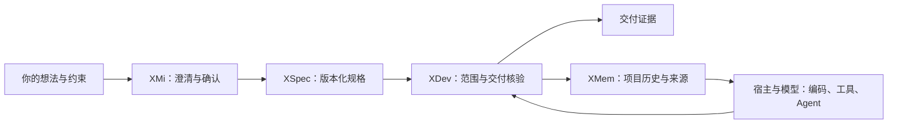

# X Suite

**让想法不止停留在原型。**

面向 Codex AI 开发流程的开源工程治理与证据链工具套件。

[English](README.md) · **简体中文**

[开始安装](INSTALL.md) · [XMi](https://github.com/NUVANU/XMi) · [XDev](https://github.com/NUVANU/XDev) · [XMem](https://github.com/NUVANU/XMem)

你描述一个产品，AI 很快写出了演示。随后，一次小改动破坏了旧规则；换个对话，之前为什么这样设计已经说不清；一句“测试通过”，却无法确定测的是不是最终交付的代码。

**X Suite 帮你把需求、项目历史和交付依据串起来，让 AI 开发更容易核对。** XMi 梳理你真正想做的产品，XDev 核对开发范围与交付证据，XMem 保存可以追溯的项目知识。实际写代码、调用工具和运行 Agent，仍由宿主与模型完成。

## 为什么值得试用？

| AI 开发中的困扰 | X Suite 提供的支持 |
| --- | --- |
| 想法很短，重要规则还没想清楚 | **XMi：**按模块讨论，保留待定问题，形成经过用户确认的规格 |
| AI 的“好建议”悄悄变成了额外功能 | **XMi + XDev：**区分提案与决定，按批准范围核对开发 |
| 新对话忘记限制，重复走过的弯路 | **XMem：**按项目检索历史，带回来源、修订版本和适用条件 |
| AI 说完成了，但不知道审查和测试对应哪份代码 | **XDev：**让实施、Review、实际 QA 对应同一 Job 与候选版本 |
| 中断后不知道上次操作是否成功 | **XDev + XMem：**先核对原记录，再判断能否重试或恢复 |

这些是套件要解决的问题，不代表已经测得“消除幻觉”或“保证产品开发成功”的效果。

## 三个工具，各司其职



| 工具 | 帮你回答的问题 | 主要产物 | 协议 |
| --- | --- | --- | --- |
| [**XMi**](https://github.com/NUVANU/XMi) | 用户真正确认要做的是什么？ | 产品模型、决策、验收标准、XSpec | Apache-2.0 |
| [**XDev**](https://github.com/NUVANU/XDev) | 这份候选代码是否具备本次交付所需的依据？ | Job 记录、范围核验、Review 与 QA 回执、交付状态 | MPL-2.0 |
| [**XMem**](https://github.com/NUVANU/XMem) | 哪些历史知识与当前任务有关，依据在哪里？ | 版本化记忆、来源引用、检索结果、检查点 | MPL-2.0 |

本仓库提供集成说明，三个工具的源码仍分别维护。XMi 可以独立使用；当前联合开发安装路径将 XDev 与 XMem 配套配置。小改动不必一律先写一份 XSpec。

## 一个例子：社区工具预约台

假设你想做一个邻里共享工具的预约应用，知道希望用户怎样使用，但不熟悉代码。

1. **用 XMi 讲清楚。**谁能预约、时间冲突怎么处理、借用人能否取消、工具不可用时怎么办？还没决定的规则继续待定。方案确认后，XMi V0.1.2 派生当前版本的 24 章架构，并通过支持宿主的已有能力一起评审需求与架构。
2. **由宿主开发，用 XDev 核对。**围绕约定的文件与功能推进，让实施、独立 Review、实际 QA 的结果分别记录，并对应到交付候选。
3. **用 XMem 接续。**换个对话，检索之前的取消规则和失败记录，查看来源及适用条件，再决定是否用于当前开发。

这是使用流程示意，不是 A/B 实测结果。产品决定、规格导出、任务授权、代码实现和交付验收，分别成立。

## XMi V0.1.2 更新

当前 XMi 源码增加增量确认、默认 **确认** 回复、版本绑定的 24 章架构，以及借助宿主已有能力的建议性独立评审。未变化的已确认内容和当前评审结果沿用，产品修改后针对新版本评审。[查看更新说明](https://github.com/NUVANU/XMi/blob/main/docs/public/RELEASE-0.1.2.md)。

XMi V0.1.2 已有现有 Windows Codex 桌面安装上的有界验收记录；与公开 XDev/XMem 配套版本重新进行端到端联合验收，仍需单独完成。

## 开始使用

**先阅读 [Windows 安装指南](INSTALL.md)。**指南包含三个仓库、插件配置、XMem 运行目录及明确的项目绑定步骤。

当前社区版安装路径使用 Windows x64、Node.js **24.20.0**、npm **11.19.0**、pnpm **11.25.0**，以及支持指南所述本地插件入口的 Codex。首次安装需下载依赖；目前提供源码安装流程，未捆绑 Node.js，也不是一键桌面安装包。

| 社区版组件 | 包版本 | 下载 |
| --- | --- | --- |
| XMi | `0.1.2` | [轻量安装包](https://github.com/NUVANU/XMi/releases/download/v0.1.2/xmi-0.1.2-lite.zip) · [源码包](https://github.com/NUVANU/XMi/releases/download/v0.1.2/xmi-0.1.2-source.zip) · [SHA-256 校验](https://github.com/NUVANU/XMi/releases/download/v0.1.2/SHA256SUMS.txt) |
| XDev | `0.1.2` | [源码 ZIP](https://github.com/NUVANU/XDev/archive/refs/heads/main.zip) |
| XMem | `0.1.1` | [源码 ZIP](https://github.com/NUVANU/XMem/archive/refs/heads/main.zip) |

表中为公开源码声明的包版本。XMi 为 **V0.1.2**，XDev 与 XMem 保持表中所列社区包版本。XMi 下载固定到 [GitHub Release v0.1.2](https://github.com/NUVANU/XMi/releases/tag/v0.1.2)：普通安装选轻量包，开发/测试选源码包，并对照附件校验值。XDev/XMem 的 `main` ZIP 随分支更新，需要复现时请记录 commit。使用配套安装说明与部署清单，升级时不要直接覆盖替换 XMem 运行目录。

安装后，建议先从一个边界明确的小项目开始：

```text
启用 XMi，和我一起梳理社区工具预约台。
请分别展示当前范围、待定问题和建议。
不要补写我尚未决定的规则，确认前先在对话中展示完整清单。
```

进入开发时，先用 `xdev_context` 核对 XDev 绑定的项目。记忆检索与项目、任务权限需要明确配置；插件已安装不等于拥有执行任务的权限。

## 技术特点

- **Skills + MCP：**用对话引导和结构化工具协作，通过校验过的契约操作项目状态。
- **明确确认：**XMi 通过领域服务保存产品决定，聊天文字本身不等于权威产品模型。
- **版本与内容绑定：**结合项目身份、任务版本、文件引用及 SHA-256，识别过期、被改动或错配的输入。
- **依据证据判断交付：**XDev 分别记录实施、Review 与实际 QA，状态声明需要对应到相关记录。
- **项目级记忆：**XMem 使用本地 SQLite、来源引用、修订记录和有载荷上限的显式检索。
- **依据原记录恢复：**遇到中断，先对账原操作，保留未知结果，避免悄悄重开或擦掉历史。

哈希核对的是内容一致性，不认证人的身份，也不证明内容正确。工具执行、沙箱权限、模型调用和 Agent 生命周期仍由宿主管理。

## 当前适用范围

公开安装路径以本地 Windows/Codex 为主。联合验收覆盖了有边界的流程：XMi 对话确认与 XSpec 导出、XDev 受控接收/Review/Node QA，以及 XMem 保存并在新会话回读。不能据此推断所有新电脑安装和异常路径都已经通过。

XDev 当前公开 MCP QA 执行器支持冻结的 Node 命令和有界运行窗口，不代表已经覆盖浏览器、游戏引擎或所有端到端验收。实际范围见 [社区操作说明](https://github.com/NUVANU/XDev/blob/main/docs/COMMUNITY.md)。

XMem 返回了记忆，也不保证模型一定正确使用。套件不含托管服务，不替代宿主或模型订阅；其他宿主、系统及后续本地开发版本需要分别验证。

本地保存也不代表所有内容都不联网：宿主可能将检索到的上下文发送给模型服务商，具体受其设置和隐私政策约束。

## 文档、贡献与反馈

- [安装套件](INSTALL.md)
- [XMi：功能、架构与已知问题](https://github.com/NUVANU/XMi)
- [XDev：项目绑定、监督流程与 QA 恢复](https://github.com/NUVANU/XDev/blob/main/docs/COMMUNITY.md)
- [XMem：工程记忆与集成](https://github.com/NUVANU/XMem)
- [反馈集成问题](https://github.com/NUVANU/X-Suite/issues)

反馈时请提供工具版本或 commit、宿主版本、最小复现步骤和脱敏错误信息。不要在公开 Issue 中上传私人项目、凭证、个人对话或记忆数据库。

## 开源协议

本仓库集成资料采用 [Apache-2.0](LICENSE)。XMi 采用 Apache-2.0；XDev 与 XMem 采用 MPL-2.0。各组件及第三方依赖保留自己的协议。
